# Отчёт о лабораторной работе 6 по Основа программирования

Выполнил студент группы 4515 Золотарев Р.А.

## Цель работы

Изучение базовых возможностей системы управления версиями, опыт работы с Git Api, опыт работы с локальным и удаленным репозиторием.

## Ход выполнения

Шаги с регистрацией GitHub и установкой Git были пропущены, так как и аккаунт на GitHub, и сам Git уже есть.

Был создан fork репозитория LR6 (рисунки 1.1 и 1.2). Затем командой git clone удалённый репозиторий был загружен локально на ПК.

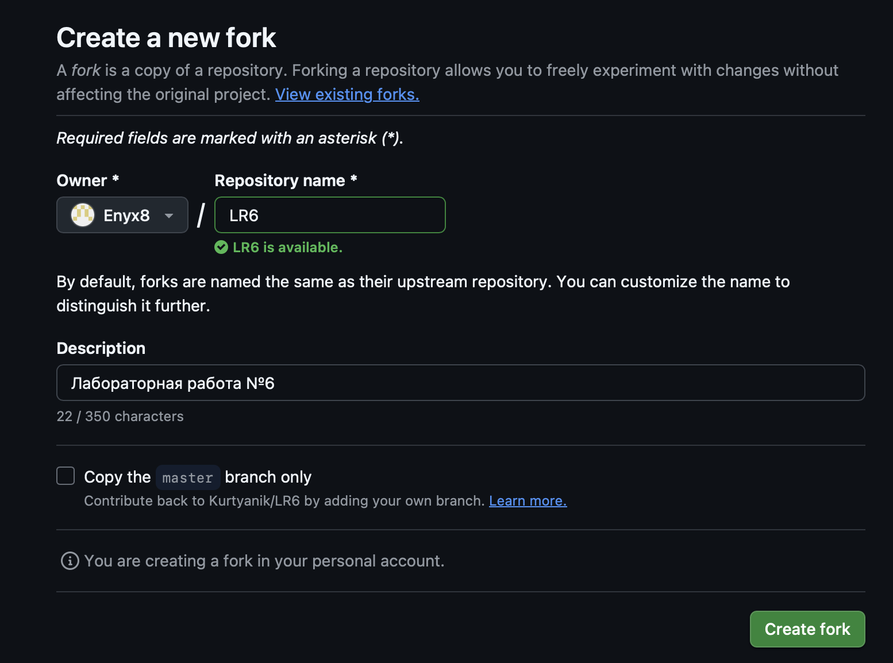
							Рисунок 1.1 - Создание форка
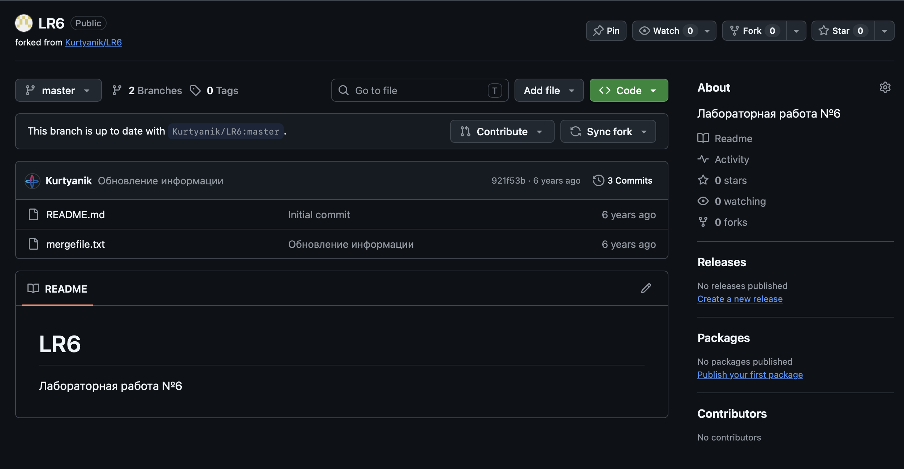
					Рисунок 1.2 - Созданный форк
В ветке main через веб-интерфейс был создан файл testFile с текстом внутри (рисунок 1.3). Командой git pull изменения из репозитория на GitHub были загружены в локальных репозиторий (рисунок 1.4).

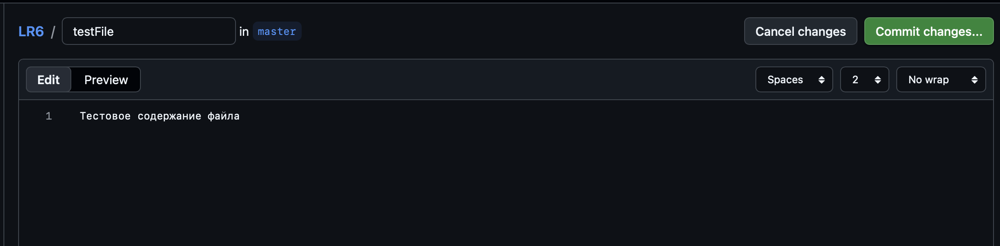
						Рисунок 1.3 - Новый файл
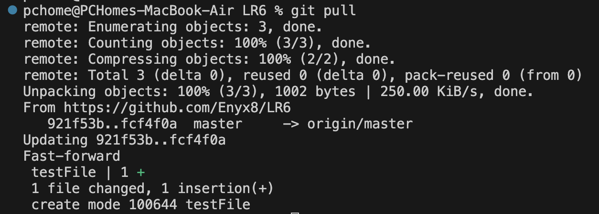
						Рисунок 1.4 - Команда git pull

Командой git log master в консоль вывелась история коммитов ветки master (рисунок 1.5). При попытке выполнить команду git log branch1 пявилась ошибка (рисунок 1.6). Причиной стало то, что ветка branch1 не была скопирована в локальный репозиторий (скачалась только ветка master). Чтобы ветка branch1 тоже была на ПК и с ней можно было работать, в консоль была введена команда git checkout branch1 (рисунок 1.7). Система увидела, что в удалённом репозитории есть такая ветка и автоматически загрузила её. Теперь команда git log branch1 выполнилась успешно (рисунок 1.8).

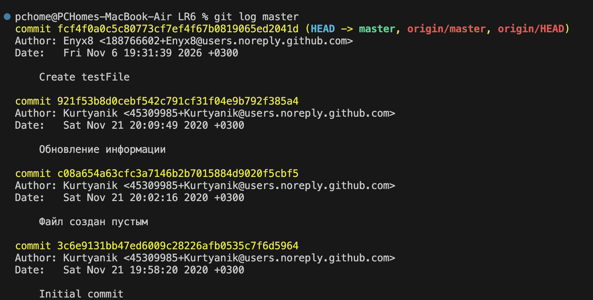
						Рисунок 1.5 - История коммитов ветки master
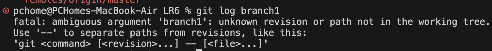
						Рисунок 1.6 - Ошибка истории коммитов
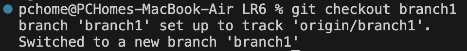
						Рисунок 1.7 - Создание локальной ветки branch1
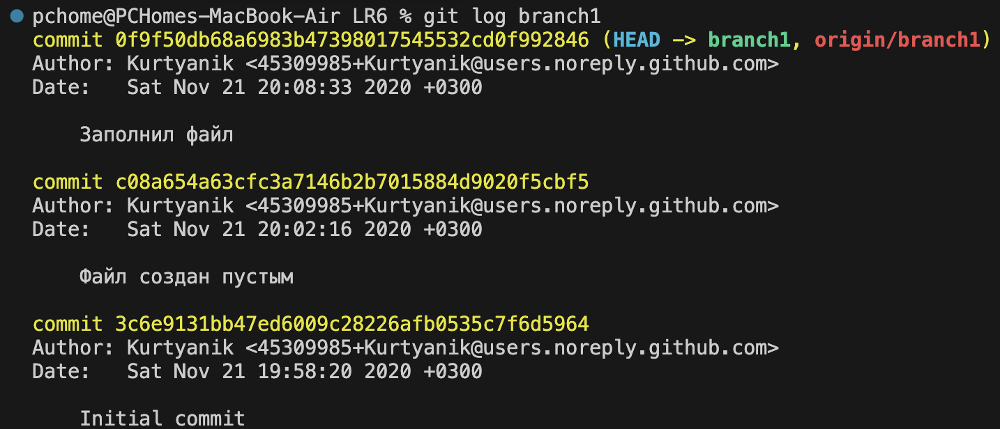
						Рисунок 1.8 - История коммитов ветки branch1

Командой git show было выведено последнее изменение в ветке master (рисунок 1.9). Хоть я и задал config.name, здесь был укзаан никнейм с сайта. Это произошло из-за того, что тот файл я создавал через веб-интерфейс, а не локально. Этой же командой я вывел последнее изменение в ветке branch1, переключившись на неё (рисунок 1.10).

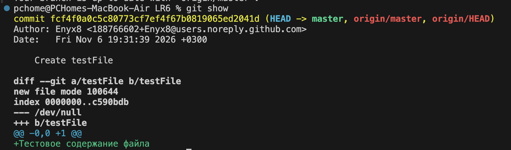
						Рисунок 1.9 - Последний коммит ветки master
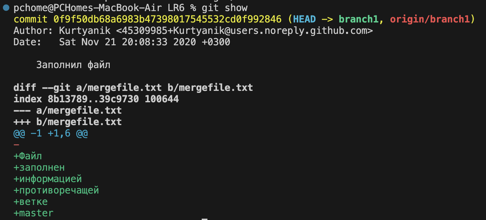
						Рисунок 1.10 - Последний коммит ветки branch1

Когда я попытался выполнить команду git merge branch1, чтобы слить изменения из ветки branch1 с веткой master, появилась ошибка с конфликтом слияния (рисунок 1.11). Чтобы исправить её, я выбрал вариант с заменой содержимого файла из ветки master на содержимое файла из ветки branch1. Это можно было сделать в файле, который виден на рисунке 1.12). В итоге содержимое файла mergefile.txt выглядит так, как на рисунке 1.13.

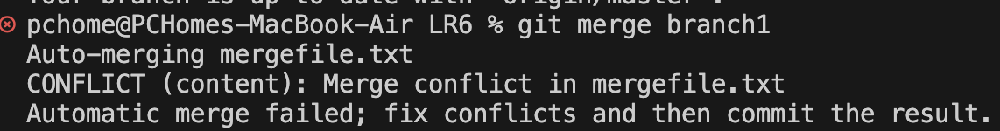
						Рисунок 1.11 - Ошибка слияния веток
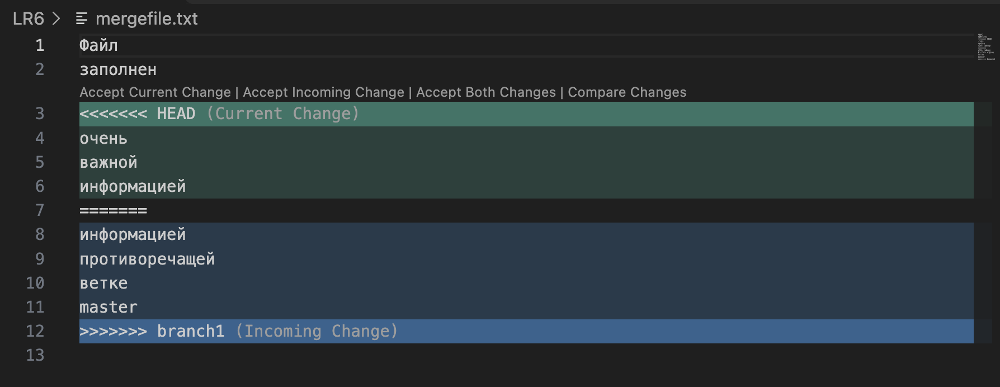
						Рисунок 1.12 - Устранение ошибки слияния веток
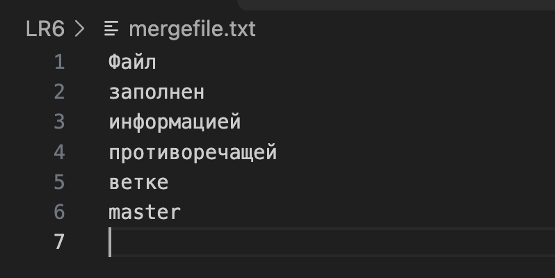
						Рисунок 1.13 - Новое содержимое файла mergefile.txt

Затем я закоммитил изменения и удалил ветку branch1 (рисунки 1.14 и 1.15).

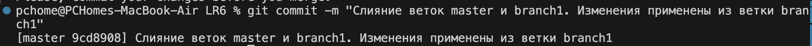
						Рисунок 1.14 - Новый коммит
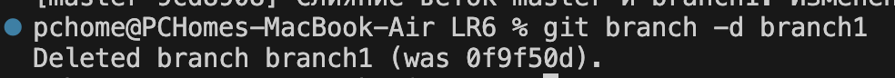
						Рисунок 1.15 - Удаление (локально) ветки branch1

Далее были созданы еще несколько тестовых файлов, а изменения были закоммичены (рисунки 1.16 и 1.17).

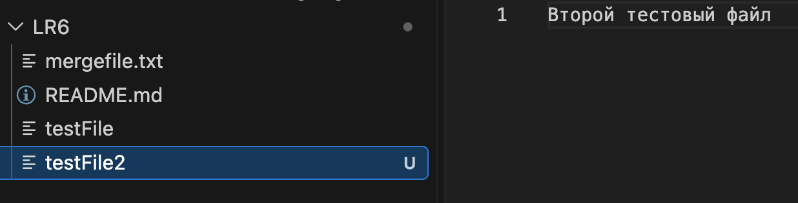
						Рисунок 1.16 - Новый тестовый файл
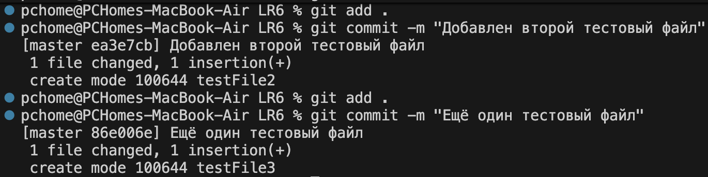
						Рисунок 1.17 - Коммиты тестовых файлов

Наконец, последнее изменение было отменено командой git revert HEAD (рисунок 1.18).

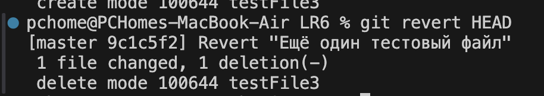
						Рисунок 1.18 - Отмена последнего коммита

История изменений в форматированном виде видна на рисунке 1.19.

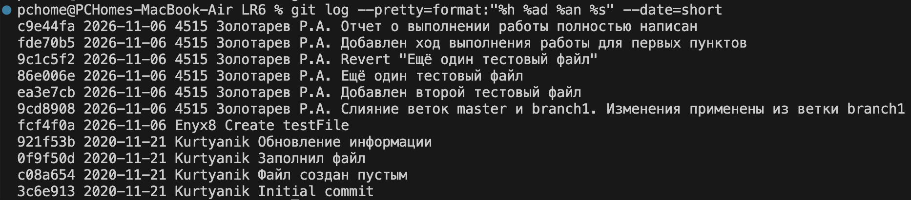
					Рисунок 1.19 - История изменений в форматированном виде